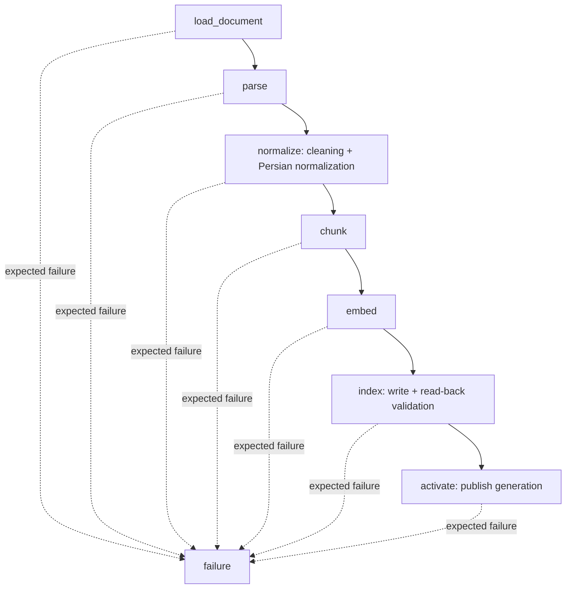
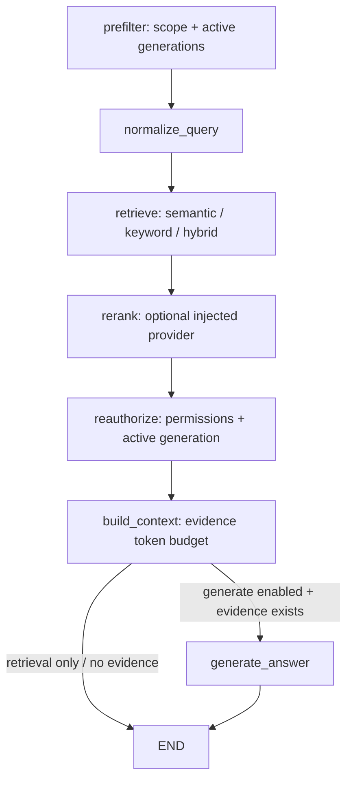

# اجرای گراف‌های همتایار، trace و دیباگ

این پیاده‌سازی مستقل از FastAPI و UI است. از ریشهٔ پوشهٔ `hamtayar` اجرا کنید، نه ریشهٔ `hamtayar-suite`.

## مسیرها و مسئولیت‌ها





نودها منطق پردازش، لاگ یا SDK مانیتورینگ ندارند. `DefaultDocumentWorkflowPorts` سرویس‌ها را به گراف ingestion وصل می‌کند و `build_pipelines()` نقطهٔ اتصال منابع هر دو گراف است.

| قسمت | کلاس / تابع اصلی | نقش |
|---|---|---|
| `apps/pipelines/runtime.py` | `build_pipelines`, `PipelineRuntime` | ساخت سرویس‌ها و کامپایل دو گراف با منابع تزریق‌شده |
| `apps/pipelines/cli.py` | `execute` | اجرای محلی بدون وب‌سرور، pause، resume، inspect |
| `apps/pipelines/local.py` | `build_local_runtime` | مدل واقعی، tokenizer موجود، Qdrant و منابع محلی |
| `apps/orchestration/execution.py` | `PipelineRunner` | اجرای streaming، timeout، خطا و کنترل هویت resume |
| `apps/orchestration/checkpointer.py` | `CheckpointerFactory`, `record_pipeline_checkpoint` | checkpoint پایدار SQLite و ثبت رویداد checkpoint |
| `apps/core/observability.py` | `PipelineTrace`, `state_summary` | trace محلی JSONL و گزارش HTML، بدون متن سند و بردار |
| `packages/ingestion/loader.py` | `DocumentLoader` | کپی ورودی در artifact repository |
| `packages/ingestion/parser_dispatch.py` | `DocumentParserDispatcher` | استفاده از پارسر TXT/Markdown موجود؛ محل تزریق PDF/DOCX |
| `packages/ingestion/normalize_service.py` | `DocumentNormalizationService` | استفاده از cleaning و normalization موجود در `packages/documents` |
| `packages/ingestion/chunking/service.py` | `DocumentChunkingService` | خواندن/نوشتن artifact و اجرای تنها الگوریتم `chunker.chunk` |
| `packages/ingestion/chunking/chunker.py` | `chunk` | ترکیب بلوک‌های سازگار تا سقف توکن؛ سیاست بلوک بزرگ: خطا |
| `packages/ingestion/embedding/provider.py` | `SentenceTransformerEmbeddingProvider`, `AsyncEmbeddingAdapter` | مدل واقعی و تبدیل رابط sync به async |
| `packages/integrations/embedding/service.py` | `EmbeddingService` | batching، تطابق بردار/چانک، بررسی ابعاد و نرمال‌سازی |
| `packages/knowledge/ingestion/facade.py` | `DefaultDocumentWorkflowPorts` | واگذاری عملیات هفت مرحله به سرویس‌ها |
| `packages/knowledge/ingestion/index_service.py` | `DocumentIndexService` | بررسی source/ACL/model، generation پایدار و `store_chunks` |
| `packages/knowledge/publication` | `LocalSqliteGenerationCatalog`, `DocumentPublicationService` | نسل تأییدشده و نسل فعال هر سند |
| `packages/storage/artifacts/repository.py` | `LocalArtifactRepository` | فایل خام و JSON خروجی مراحل، refs با checksum و جداسازی tenant/source |
| `packages/retrieval/workflow_service.py` | `RetrievalWorkflowService` | اتصال جست‌وجوی موجود، فیلتر نسل فعال، RRF برای hybrid و reauthorization |
| `packages/answering/service.py` | `select_context`, `validate_answer` | بودجهٔ شواهد و تطبیق دقیق citation با شواهد مجاز |
| `packages/integrations/chat.py` | `ChatAnswerGenerator` | adapter اختیاری Chat Completions سازگار با OpenAI |

پکیج‌های جدید موردنیاز از آرشیو `packages.rar` آورده شده‌اند. پکیج‌های `documents` و tokenizer فعلی مخزن حفظ شده‌اند و سرویس‌ها از آن‌ها استفاده می‌کنند. `api`، worker و UI به این runtime متصل نشده‌اند؛ مسیر فعلی API همان رفتار قبلی خود را دارد.

## نصب

```powershell
cd D:\Hamtayar-GitHub\hamtayar
uv sync --extra workflows --extra dev
```

مدل، tokenizer، revision و ابعاد در `config/knowledge.toml` تعیین می‌شوند. پیش‌فرض مخزن `BAAI/bge-m3` با ۱۰۲۴ بعد است. دانلود اولیهٔ وزن‌ها و tokenizer به شبکه و فضای کافی نیاز دارد. برای اجرای بدون دانلود، ابتدا cache را پر کنید و `tokenizer_local_files_only=true` بگذارید؛ این گزینه در wiring محلی برای مدل هم اعمال می‌شود.

## آماده‌سازی Qdrant توسعه

اگر Qdrant موجود دارید، همان را استفاده کنید. برای نمونهٔ مستقل محلی:

```powershell
docker run -d --name hamtayar-pipeline-qdrant -p 6333:6333 qdrant/qdrant:v1.20.0
uv run python -m infra.qdrant.provision_pipeline
```

دستور provisioning کالکشن `hamtayar_search_pipeline`، بردار `dense` با ابعاد کانفیگ و distance=Cosine و ایندکس‌های payload را آماده می‌کند. داده یا کالکشن موجود را حذف نمی‌کند؛ ناسازگاری vector profile خطا می‌دهد. این دستور فقط نام‌های توسعهٔ مجاز را قبول می‌کند. keyword و hybrid به ایندکس text با scoring=BM25 نیاز دارند.

در صورت استفاده از آدرس یا کالکشن دیگر، آن را در هر دو دستور provisioning و CLI با `--url`/`--qdrant-url` و `--collection` یکسان بدهید. provisioning توسعه فقط prefixهای موجود در `guard_collection_name` را می‌پذیرد.

## اجرای ingestion

```powershell
uv run python -m apps.pipelines.cli --local-access ingest .\samples\document.md --source-id demo-001 --space demo --version 1
```

`--local-access` یک انتخاب صریح برای اجرای تک‌کاربرهٔ توسعه است؛ احراز هویت پادین نیست و توسط API استفاده نمی‌شود. پیش‌فرض محلی tenant=`local` و principal=`user:local` است. می‌توانید `--tenant`، `--subject` و `--principal` را پیش از نام فرمان بدهید. در استقرار چندکاربره باید authorization واقعی تزریق شود.

فایل ورودی باید داخل پوشهٔ کاری یا یکی از `--allowed-root`های صریح باشد. نمونه برای فایل بیرون مخزن:

```powershell
uv run python -m apps.pipelines.cli --local-access --allowed-root D:\Documents ingest D:\Documents\sample.txt --source-id demo-002 --space demo
```

خروجی شامل `run_id`، تعداد چانک‌های ایندکس‌شده، وضعیت انتشار و مسیر trace است. تکرار همان سند/نسخه/تنظیمات/ACL، generation پایدار می‌سازد و نقاط تکراری ایجاد نمی‌کند. شکست قبل از activate نسل قبلی را جایگزین نمی‌کند.

TXT و Markdown آماده‌اند. PDF و DOCX فقط پس از تزریق parser واقعی در `build_pipelines(binary_parsers=...)` قابل پردازش‌اند. فعلاً OCR یا parser ساختگی اضافه نشده است.

## اجرای retrieval و پاسخ

فقط بازیابی شواهد، بدون LLM:

```powershell
uv run python -m apps.pipelines.cli --local-access query "این سند درباره چیست؟" --mode semantic
uv run python -m apps.pipelines.cli --local-access query "معماری" --mode keyword
uv run python -m apps.pipelines.cli --local-access query "معماری سامانه" --mode hybrid --source-id demo-001
```

در hybrid، نتایج semantic و BM25 با Reciprocal Rank Fusion و ثابت ۶۰ ترکیب می‌شوند. reranker جداگانه پیش‌فرض ندارد؛ ترتیب جست‌وجو حفظ و `reranked=false` ثبت می‌شود. reranker واقعی از `build_pipelines(reranker=...)` قابل تزریق است.

فقط نسل‌های فعال در scope درخواست جست‌وجو می‌شوند. پس از جست‌وجو، نسل فعال و مجوز دسترسی دوباره بررسی می‌شوند. اگر شواهد نماند یا داخل بودجهٔ context جا نگیرد، مدل فراخوانی نمی‌شود و وضعیت `no_evidence` برمی‌گردد.

پاسخ با مدل واقعی اختیاری است:

```powershell
$env:HAMTAYAR_LLM_BASE_URL = "https://your-provider.example/v1"
$env:HAMTAYAR_LLM_MODEL = "your-model-id"
# کلید را در محیط اجرا یا secret manager تنظیم کنید؛ در کد یا Git قرار ندهید.
uv run python -m apps.pipelines.cli --local-access query "این سند چه می‌گوید؟" --mode semantic --generate
```

adapter محلی از `HAMTAYAR_LLM_API_KEY` در محیط استفاده می‌کند. این adapter فقط **Chat Completions** را پیاده می‌کند؛ endpointهای فقط Responses API باید adapter جداگانهٔ `generate(AnswerRequest) -> AnswerResponse` تزریق کنند. TLS با تنظیمات استاندارد httpx بررسی می‌شود. citation ناشناخته یا ناسازگار خطا می‌دهد؛ تطبیق citation، اثبات درستی معنایی تمام متن پاسخ نیست.

## trace محلی

هر اجرا این خروجی‌ها را می‌سازد:

- `.runtime/pipelines/checkpoints.sqlite`: وضعیت کامل مراحل برای ادامه و دیباگ.
- `.runtime/pipelines/catalog.sqlite`: نسل‌های تأییدشده و فعال.
- `.runtime/pipelines/artifacts`: فایل ورودی و خروجی مراحل.
- `.runtime/pipelines/traces/<run_id>.jsonl`: رویدادهای ساختاریافته.
- `.runtime/pipelines/traces/<run_id>.html`: گزارش قابل بازشدن در مرورگر.

در HTML، زمان UTC، شروع/پایان هر نود، مدت اجرای نود، checkpoint، وضعیت و خطا دیده می‌شود. JSONL و terminal هم‌زمان به‌روز می‌شوند؛ HTML در پایان، توقف یا خطا ساخته می‌شود. متن سند، سؤال، بردار و کلید در trace محلی ثبت نمی‌شود. checkpoint و artifact دادهٔ کامل دارند؛ `--show-content` عمداً آن را به اپراتور محلی نمایش می‌دهد. پوشهٔ `.runtime` در Git نادیده گرفته می‌شود.

```powershell
Start-Process ".runtime\pipelines\traces\<run_id>.html"
Get-Content ".runtime\pipelines\traces\<run_id>.jsonl" -Wait
```

## توقف، بررسی و ادامه

```powershell
uv run python -m apps.pipelines.cli --local-access --pause-after parse ingest .\samples\document.md --source-id demo-003 --space demo
```

اجرا بعد از `parse` متوقف می‌شود و `next` مرحلهٔ بعد را نشان می‌دهد. مقدار واقعی run_id چاپ‌شده را جایگزین کنید:

```powershell
uv run python -m apps.pipelines.cli --local-access inspect <run_id> --history
uv run python -m apps.pipelines.cli --local-access inspect <run_id> --show-content
uv run python -m apps.pipelines.cli --local-access resume <run_id> --workflow ingestion
```

برای retrieval هم `--pause-after retrieve` و `--workflow retrieval` استفاده کنید. گزینه‌های عمومی از جمله `--pause-after`، `--config` و `--work-dir` باید پیش از `ingest/query/resume` باشند.

resume به همان work-dir، کانفیگ، هویت و منابع دسترسی نیاز دارد. درخواست جدید به checkpoint قبلی اضافه نمی‌شود. تغییر هویت در resume رد می‌شود. برای اجرای جدید run_id تازه ساخته می‌شود. ذخیرهٔ SQLite امکان ادامه بعد از بستن برنامه را فراهم می‌کند؛ runtime context و مجوزها مجدداً تأمین می‌شوند.

پس از خطای گذرای provider می‌توان با رفع علت و فرمان resume همان نود را دوباره اجرا کرد. خطای اعتبارسنجی که به نود failure رسیده با تغییر خودکار state نادیده گرفته نمی‌شود؛ ورودی را اصلاح کنید و اجرای جدید بسازید. timeout و لغو عملیات thread تعاونی است؛ عملیات sync در حال اجرا ممکن است تا پایان ادامه یابد، بنابراین timeout به معنی rollback نوشتن نیست.

## دیباگ کد و نمودار گراف

پوشهٔ `hamtayar` را در VS Code باز کنید، interpreter پروژه را انتخاب کنید و از Run and Debug یکی از تنظیمات `.vscode/launch.json` را اجرا کنید. breakpoint معمولی در نود یا سرویس بگذارید؛ مثلاً `DocumentParserDispatcher.parse`، `chunker.chunk`، `DocumentIndexService.index` یا نود `retrieve`. مشاهدهٔ state بین مراحل با checkpoint است؛ بررسی متغیرهای داخل تابع با debugger انجام می‌شود.

برای نمایش traceback محلی گزینهٔ `--debug` را پیش از فرمان بدهید. برای debugger خط فرمان:

```powershell
uv run python -m pdb -m apps.pipelines.cli --local-access ingest .\samples\document.md --source-id debug-001 --space demo
```

تولید نمودار واقعی از گراف کامپایل‌شده، بدون اجرای مدل یا اتصال دیتابیس:

```powershell
uv run python -m apps.pipelines.cli diagrams
```

دو فایل `.mmd` در work-dir ساخته می‌شود. با افزونهٔ Mermaid در editor قابل مشاهده‌اند؛ این نمودارها topology را نشان می‌دهند و timeline اجرای واقعی در trace است.

## LangSmith اختیاری

LangGraph از tracing استاندارد LangSmith پشتیبانی می‌کند. برای فعال‌سازی اختیاری قبل از اجرای CLI:

```powershell
$env:LANGSMITH_TRACING = "true"
$env:LANGSMITH_PROJECT = "hamtayar-pipelines"
# LANGSMITH_API_KEY را از تنظیمات امن محیط تأمین کنید.
```

این گزینه می‌تواند ورودی/خروجی نودها را به سرویس خارجی بفرستد؛ برخلاف trace محلیِ بدون محتواست. برای بررسی اسناد سازمانی، تنها در مقصد موردتأیید سازمان فعال کنید. ما در تست‌ها این ارسال را فعال نکرده‌ایم و پروژهٔ ابری ایجاد نکرده‌ایم. خاموش‌کردن:

```powershell
$env:LANGSMITH_TRACING = "false"
```

مراجع رسمی: https://reference.langchain.com/python/langgraph/types/StreamMode و https://langchain-ai.github.io/langgraph/tutorials/rag/langgraph_agentic_rag/

## اتصال به authorization واقعی و FastAPI در مرحلهٔ بعد

`build_pipelines()` منابع را تزریق می‌گیرد. CLI همچنین `--factory your_module:build_runtime` می‌پذیرد. factory با `(args, checkpointer)` فراخوانی می‌شود و `(PipelineRuntime, TrustedAccessContext)` برمی‌گرداند؛ می‌تواند async باشد. این context باید از integration معتبر پادین بیاید.

authorization تزریقی برای ingestion متد `authorize_action(context=..., source=..., action='ingest'|'publish') -> AccessMetadata` و برای retrieval متد `authorize_sources(context, sources)` را فراهم کند. صرف ساختن AccessMetadata به معنی احراز هویت نیست. factory مسئول ثبت parserها، مدل‌ها، scope منابع و عمر clientهای متعلق به خود است؛ CLI عمر checkpointer را مدیریت می‌کند. runtime محلی فقط برای محیط توسعهٔ تک‌کاربره است؛ artifact و catalog محلی برای استقرار چند نمونه کافی نیستند.

FastAPI بعداً همین runtime و runner را از lifespan دریافت می‌کند؛ نباید سرویس‌ها و مدل‌ها در هر request ساخته شوند.

## تست و حدود تأیید

```powershell
uv run pytest test/workflows test/architecture -q
```

تست‌های workflow از LangGraph واقعی، فایل‌های artifact واقعی، Hazm، SQLite و Qdrant embedded واقعی استفاده می‌کنند. مدل امبدینگ، شمارندهٔ توکن و پاسخ‌گو در تست‌ها **بدل آزمایشی صریح** هستند؛ این تست‌ها ارزیابی کیفیت مدل واقعی نیستند. تست‌ها مسیر موفق، MIME، نبود parser، idempotency، عدم انتشار پیش از تأیید، محدودیت context، کنترل دسترسی، citation نامعتبر، شکست provider و resume پس از بازکردن مجدد SQLite را می‌پوشانند.

نتیجهٔ بررسی این تغییر: **۸۱۱ تست موفق، ۶۸ تست skipped**؛ Ruff روی فایل‌های مرتبط و `uv lock --check` موفق شدند. تست‌های نیازمند سرویس خارجی طبق تنظیمات موجود مخزن skipped شده‌اند. مدل واقعی SentenceTransformer و endpoint زندهٔ LLM در این محیط اجرا نشده‌اند؛ نتیجهٔ موفق تست‌های بدل مدل را به‌عنوان تأیید inference واقعی گزارش نمی‌کنیم. trace ابری LangSmith هم در این محیط تست نشده است.
